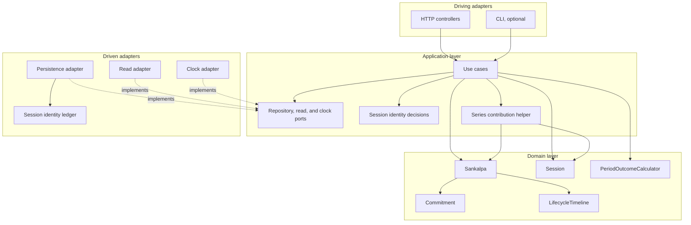

# Sankalpa — Domain-Driven Architecture

This folder describes a lean domain model and ports-and-adapters architecture for
[Sankalpa](../../requirements/sankalpa.md) and
[Linked Sankalpa Extensions](../../requirements/linked-sankalpa-extensions.md).
These documents describe the target architecture; code may still implement earlier contracts.

The reference material in `/Users/prashantwani/wrk/computer-setup/ai/reference/ddd-hexagonal/`
is used as guidance, not as a rulebook. Patterns are included only when they pay for themselves in
this project.

## Domain Vision

Sankalpa helps a user record a declared intent, track sessions against that commitment,
see whether each period was satisfied, and celebrate separately completed vows in a linked series.

The value is in the commitment arithmetic and lifecycle rules, not in elaborate architecture.

## Reading Order

| # | Document | What it answers |
|---|---|---|
| 01 | [Strategic design](01-strategic-design.md) | Why this is one bounded context and not a set of subdomains |
| 02 | [Ubiquitous language](02-ubiquitous-language.md) | Terms used by the requirements and the model |
| 03 | [Domain model](03-domain-model.md) | Aggregates, value objects, invariants, lifecycle, errors |
| 04 | [Recorded facts](04-recorded-facts.md) | Audit/history without speculative event infrastructure |
| 05 | [Application layer](05-application-layer.md) | Use cases, ports, commands, queries |
| 06 | [Hexagonal architecture](06-hexagonal-architecture.md) | Package shape, adapters, persistence |
| 07 | [Design decisions](07-design-decisions.md) | Decisions kept, decisions removed, and why |
| 08 | [Testing strategy](08-testing-strategy.md) | Tests proportional to the model |
| 09 | [Open questions](09-open-questions.md) | Unresolved requirement gaps intentionally left outside the design |
| 10 | [Possible requirement amendments](10-requirement-amendments.md) | Optional clarifications before expanding scope |
| 11 | [Linked extensions](11-linked-extensions.md) | Series membership, shared sessions, extension transactions, client compatibility |
| 12 | [Linked extension review](12-linked-extension-review.md) | Review findings, fixes, and final architecture assessment |

## Architecture At A Glance

## Current Scope

Included because the requirements need it:

- One bounded context: `Sankalpa`.
- A `Sankalpa` aggregate for commitment and lifecycle rules.
- A separate `Session` record/aggregate so session history can grow without bloating `Sankalpa`.
- Stable session identities, replay-safe logging, and permanent session deletion.
- Explicit linked extensions with independent lifecycles and completion achievements.
- One recorded session with derived contributions to eligible vows in its series.
- Value objects only for values with rules: commitment, period unit/count, number of times, title,
  description, period windows, lifecycle timeline.
- A period-outcome calculator because the result spans commitment, lifecycle, and sessions.
- Ports around persistence, reads, and time.

Deliberately not included yet:

- Separate subdomains or bounded contexts.
- Server domain events, event dispatcher, server outbox, process manager, command bus, or
  integration events. The iOS durable operation journal is a client reliability mechanism, not a
  server event outbox.
- Identity/accounts, activity catalogue, reminders, notifications, streaks, scoring, social
  features, session editing, sankalpa edit/delete flows, or per-sankalpa time zones.
- DDD specification objects where a method or named helper is clearer.

## Requirements Traceability

| Requirement | Carried by |
|---|---|
| Title and description | `Title`, `Description` |
| Start date, optional duration, derived end date | `Commitment` |
| Action type, period, number of times | `ActionType`, `PeriodUnit`, `TimesPerPeriod` |
| Duration must be a whole number of periods | `PeriodCount`; no other duration shape is represented |
| Month/year boundaries stay anchored to the original start date | `Commitment` derives every boundary from start plus period index |
| More than the number of times still satisfies | `PeriodOutcomeCalculator` compares performed count with a minimum |
| Performed session date/time | `Session` |
| Log only past sessions within commitment coverage and while In progress | `Sankalpa.logSession`, `Commitment`, `LifecycleTimeline` |
| Linked duration extension preserves each vow | `Sankalpa.extend`, immutable series/source links, unique direct child |
| History inheritance includes old start dates and pauses | Extension factory and copied timeline with transition origin |
| Existing and future sessions count toward eligible linked vows | Series contribution helper using `acceptsPerformedAt` |
| Shared sessions count once in the journal | Union of unique `SessionId` facts |
| Separate completion and celebration | Independent terminal transitions and derived successful-vow list |
| One logging action records at most once across retries | Client-generated `SessionId` plus server session-identity ledger |
| Rapid repeat requires confirmation but remains a legitimate session | Series-scoped client interaction coordinator; each confirmed action receives a new `SessionId` |
| Immediate Undo and permanent later deletion | `DeleteSession` using the exact session identity |
| Deleted sessions change all history and outcome calculations | Physical session removal; every calculation reads active sessions only |
| Pending create/delete remains durable and visible | iOS operation journal and snapshot overlay |
| Pending refusal corrects state and informs the user | Durable reconciliation notice plus overlay removal |
| Pending work never crosses service data stores | Capability negotiation plus persistent service instance identity |
| Start date can be up to one year in the past | `Sankalpa.declare`; extensions preserve the inherited date |
| No duration means tracked until stopped | `Commitment` plus terminal lifecycle state |
| Lifecycle states and allowed transitions | `LifecycleState` transition table |
| Lifecycle transitions audit logged | `LifecycleTimeline` |
| Time spent Paused does not extend end date | `Commitment.endDate()` is derived, not stored |
| End date does not automatically change lifecycle | `Commitment` and lifecycle remain independent |
| Completion or stop excludes partial and later periods | `PeriodOutcomeCalculator` applies the terminal transition as a cutoff |
| Single-user application | No user/account identity or ownership model |
| Inclusive end date | `Commitment.endDate()` returns the last covered date |
| Missed count is derived from performed sessions | `PeriodOutcomeCalculator` |
| Pauses do not shift or prorate periods | `PeriodOutcomeCalculator` evaluates partial-pause windows normally and reports only fully paused windows as `PAUSED` |
| Backdated Begin | `LifecycleTimeline` separates effective time from recorded time for the first transition |
| Later lifecycle transitions happen now | Their effective and recorded timestamps are equal |
| Lifecycle/session consistency | Session logging checks commitment coverage and lifecycle state at occurrence time |
| Long-running outcome history | `GetPeriodOutcomes` and session reads are date-range bounded |

The cross-system mechanics behind these rows are specified in
[Session Reliability And Correction Design](../../design/session-reliability/README.md).

Linked-series changes to the earlier per-owner read and client assumptions are specified in
[Linked extensions](11-linked-extensions.md).

The implemented [conversational batch-session amendment](../../design/conversational-batch-sessions/README.md)
adds bounded application orchestration over existing session commands (DD-33), with no new domain
aggregate, event infrastructure, session copying, or bulk persistence endpoint.

The accepted [Assistant conversation requirements](../../requirements/assistant-conversations.md)
have a [reviewed design](../../design/assistant-conversations/README.md) and
[dry-run record](../../design/assistant-conversations/review-and-dry-run.md), dated October 21, 2026.
Implementation and local verification are recorded in the [implementation review](../../design/assistant-conversations/implementation-review.md). DD-34 adds client interaction storage and navigation over existing
thread/proposal contracts; it introduces no domain aggregate, session fact, server transcript store
or persistence schema change.
